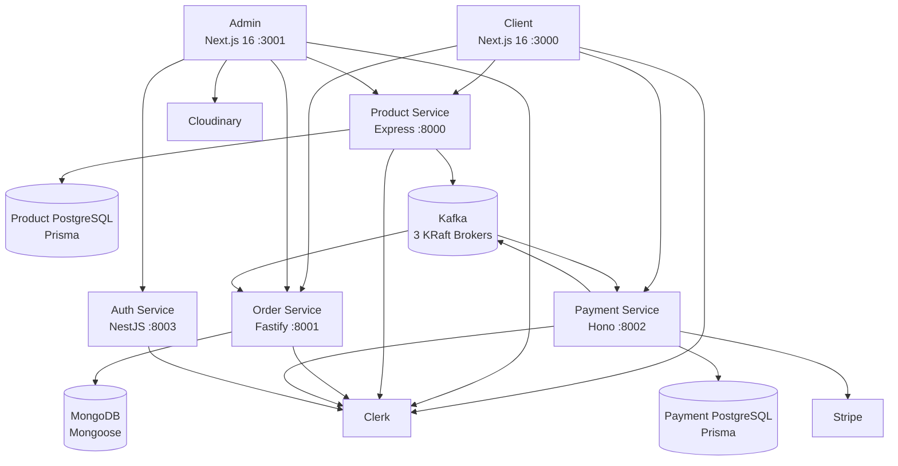
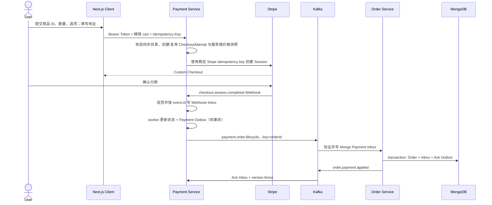

# 00｜一周学习路线与项目介绍

> **当前分支校对 · 2026-09-25：** 先用 [项目总览](../项目总览与迭代规划.md)找代码，再用本章练习口述。目录与支付订单可靠链路已有代码；库存预占和履约 Saga 仍是后续任务。

## 本章目标

- 建立完整系统地图，而不是只记零散技术。
- 能在 30 秒和 2 分钟内介绍项目。
- 明确一周每天的输入、输出与自测标准。

建议耗时：**2 小时**，之后每天回看 10 分钟。

## 1. 项目架构

### 服务职责

| 模块            | 职责                                                                              | 关键代码                                                   |
| --------------- | --------------------------------------------------------------------------------- | ---------------------------------------------------------- |
| Client          | 商品浏览、搜索筛选、详情、多规格购物车、结算、订单中心                            | `apps/client/src/app`、`components`、`stores/cartStore.ts` |
| Admin           | 商品/分类/用户管理、订单列表、统计图表                                            | `apps/admin/src/app/(dashboard)`、`components`             |
| Product Service | 商品与分类 CRUD、事务 Outbox、同步状态与结果消费                                  | `apps/product-service/src`                                 |
| Order Service   | 用户/管理员订单查询、图表聚合、消费支付事件创建订单                               | `apps/order-service/src`                                   |
| Payment Service | 创建 Stripe Checkout Session、验证 Webhook、商品 Inbox/账本、Stripe worker 与对账 | `apps/payment-service/src`                                 |
| Auth Service    | 通过 Clerk Backend API 管理用户、执行管理员授权                                   | `apps/auth-service/src`                                    |
| Shared Packages | Kafka 封装、Product/Payment 数据库客户端、共享类型与工程配置                      | `packages/`                                                |

## 2. 核心业务链路

### 商品创建与 Stripe 同步

#### 【当前实现】目录同步

1. 创建、更新或删除商品时，Product Service 在同一个 Prisma 事务里写 Product 状态与版本化 `ProductOutboxEvent`；删除保留 `ARCHIVE` tombstone。
2. Outbox dispatcher 通过数据库 lease 多实例安全认领，以商品 ID 作为 Kafka key 发布 `catalog.product.sync.requested`，发布失败持续退避重试。
3. Payment Service 消费后在同一事务写 `CatalogInboxEvent` 并 upsert `StripeCatalogItem`，持久化成功后即可提交 Kafka offset；重复和乱序事件由 event ID 与版本条件处理。
4. 独立 Stripe worker 使用派生 idempotency key 执行 UPSERT/ARCHIVE；改价创建新 Price、切换 `default_price` 并停用旧 Price，删除只归档而不物理删除 Stripe 对象。
5. 当前版本应用成功或永久失败后，Payment Service 通过 `PaymentOutboxEvent` 发布 `catalog.product.sync.result`；Product Service 仅接受与当前 `catalogVersion` 相等且 revision 更新的结果。
6. Product 公共列表/详情在 `CATALOG_SYNC_ENFORCEMENT=true` 后只展示已同步商品；Checkout 始终要求 Payment DB 中已确认同步的 Stripe Price ID，否则返回 `409 CATALOG_SYNC_PENDING`。定时对账检查缺失、漂移和本系统孤儿对象。

**【历史背景】** 改造前的 `product.created` 直接发送会留下“商品已提交、Kafka 未发布”的双写窗口。当前通过 Outbox/Inbox、Stripe 幂等、版本和对账实现最终一致，不承诺跨 PostgreSQL、Kafka、Stripe 的 exactly-once。

### 支付与订单创建

**亮点：** 支付服务不信任购物车传来的名称和价格；Checkout、Webhook、Payment Outbox、Order Inbox/Mongo transaction、Ack 和对账形成恢复闭环。首次失败支付不创建 Order，成功支付在 Ack 到达前向用户显示“订单创建中”。

**剩余风险：** 当前没有库存预占与扣减、主动退款/履约 Saga、retry topic/DLQ 和生产级指标告警；实现的是可验证的本地可靠性基线，不宣称已经承载生产流量。

### 鉴权链路

1. Client/Admin 由 `ClerkProvider` 提供会话。
2. Admin 的 `proxy.ts` 保护非公开路由并检查 `metadata.role === 'admin'`。
3. Server Component 使用 `auth().getToken()` 获取 Token。
4. 请求通过 `Authorization: Bearer <token>` 传给后端。
5. Express/Fastify/Hono/NestJS 各自使用 Clerk SDK 验证身份。
6. 管理接口再次检查 session claims 中的角色。

**关键认识：** 页面保护只改善用户体验，真正的安全边界必须在每个后端写操作上再次授权。

## 3. 项目介绍模板

### 30 秒版本

> 我完成了一个 TypeScript 全栈电商项目，使用 Turborepo 管理 Next.js 商城、后台和四个 Node.js 服务。Product 与 Payment 各用 PostgreSQL，Order 用 MongoDB；Kafka 串起商品目录同步与支付订单事件。项目重点是把 Stripe 外部调用和跨服务事务之间的失败窗口，用 Outbox/Inbox、幂等、版本和对账做成可恢复链路，并明确库存与生产运维仍待完善。

### 2 分钟版本

> 这个项目的目标是完整实践现代全栈电商链路。前端包括 Next.js 16 商城和管理后台：商城覆盖商品搜索筛选、动态详情、多规格购物车、地址校验、Stripe Custom Checkout 和订单中心；后台覆盖商品、分类、用户、订单管理和统计图表。
>
> 后端按领域拆成四个服务。商品服务使用 Express + Prisma + PostgreSQL，订单服务使用 Fastify + Mongoose + MongoDB，支付服务使用 Hono 对接 Stripe，用户服务使用 NestJS 调用 Clerk Backend API。各应用共享 TypeScript 类型、Kafka 客户端和数据库包。
>
> 跨服务协作采用同步 HTTP 与异步 Kafka 结合：商品变更和事件在一个数据库事务提交，由 Outbox 可靠发布；支付服务先把目录事件写入 Inbox/同步账本，再由可重试 worker 幂等同步 Stripe。Checkout 使用稳定幂等键。Stripe Webhook 验签后先按 event ID 落 Payment Inbox，worker 在同一事务更新支付账本并写生命周期 Outbox；Order 侧用 Mongo replica-set 事务提交 Inbox、完整快照投影与 Ack Outbox。鉴权由 Clerk 提供，管理员权限来自 session claims。
>
> 这套架构的价值是让我实践了完整链路和多框架边界。目录与支付订单两条链路都已完成 Inbox/Outbox、幂等重试、完整快照版本控制和对账，但我不会把整个交易系统说成已经生产级：仍缺库存事务、主动退款/履约 Saga、retry topic/DLQ 和完整可观测性。面向真实团队，我会根据规模减少不必要的框架异构，并继续优先保证交易正确性。

## 4. 三个高频项目追问

### 为什么使用微服务？

**【面试表达】**

> 我按商品、订单、支付和身份领域拆分，主要为了练习服务边界、独立数据模型和事件驱动。它带来了独立演进与故障隔离的可能，但也引入部署、观测、数据一致性和测试成本。对于当前规模，模块化单体可能更经济；真实选型会根据团队人数、发布频率、流量差异和合规隔离决定，而不是默认上微服务。

### 为什么每个服务用了不同框架？

**【面试表达】**

> 项目中的异构框架是有意识的技术验证：Express 生态通用，Fastify 强调 schema 和性能，Hono 轻量且基于 Web Standards，NestJS 提供完整工程结构。它适合个人学习，但团队生产环境通常应收敛到一到两套标准，否则鉴权、错误格式、日志和运维都要重复建设。我主选 NestJS，性能敏感时可采用 Fastify adapter。

### 项目中最难的部分是什么？

**【面试表达】**

> 难点不是接入 Stripe SDK，而是定义每一个不能共享事务的一致性边界。目录侧把 Product 与 Outbox 原子提交、Kafka Inbox 去重、Stripe 幂等重试和版本防乱序落到代码；支付订单侧把 Webhook event ID、Payment Outbox、Order Inbox、Mongo 事务、Ack 和跨账本对账落到代码。这让我能解释 worker 在“外部成功、本地确认前崩溃”等窗口为什么仍可恢复。

## 5. 7 天学习路线

### Day 1：项目地图与 Next.js 基础（3 小时）

- **输入**：本章；[Next.js 专题](./01-Next.js全栈前端与性能优化.md)前半部分。
- **代码回看**：`apps/client/src/app`、`components/ProductList`、`stores/cartStore.ts`。
- **口述**：30 秒与 2 分钟项目介绍各三遍。
- **输出**：手画系统架构图；列出 5 个 Server Component 和 5 个 Client Component 的判定依据。
- **自测**：不看资料解释 SSR、SSG、ISR、RSC 的区别。

### Day 2：Next.js 性能、缓存与 SEO（3 小时）

- **输入**：[Next.js 专题](./01-Next.js全栈前端与性能优化.md)后半部分。
- **代码回看**：商品列表、商品详情、`generateMetadata`、后台数据请求。
- **口述**：为商品列表、商品详情、订单页分别设计缓存策略。
- **输出**：一张“页面类型 → 渲染 → 缓存 → 失效”的表。
- **自测**：解释 `revalidatePath` 与 `revalidateTag`；说出 LCP/INP/CLS 的优化方向。

### Day 3：认证授权与 NestJS（3.5 小时）

- **输入**：[认证专题](./02-Clerk认证授权与自研方案.md)、[NestJS 专题](./03-Node.js微服务框架与NestJS.md)前半部分。
- **代码回看**：两个 `proxy.ts`、四个服务的 auth middleware/guard。
- **口述**：Clerk vs 自研；Guard/Pipe/Interceptor/Filter 的顺序和职责。
- **输出**：画一张自研 Access/Refresh Token 流程图。
- **自测**：回答“JWT 如何退出登录”“页面拦截为何不能代替接口鉴权”。

### Day 4：NestJS 工程化与数据库（3 小时）

- **输入**：[NestJS 专题](./03-Node.js微服务框架与NestJS.md)后半部分、[数据库专题](./04-数据库选型建模事务与ORM.md)前半部分。
- **代码回看**：`auth-service` 模块结构、Prisma schema、Mongoose Order schema。
- **口述**：为什么商品用 PostgreSQL、订单用 MongoDB；真实项目会不会继续这样选。
- **输出**：设计 Product/SKU/Inventory/Order/OrderItem/Payment 表。
- **自测**：解释范式、反范式、复合索引顺序和 N+1。

### Day 5：事务、Kafka 与一致性（3.5 小时）

- **输入**：[数据库专题](./04-数据库选型建模事务与ORM.md)后半部分、[Kafka 专题](./05-Kafka事件驱动与可靠性.md)。
- **代码回看**：`packages/kafka`、Product Outbox、Payment catalog worker、`stripeWebhookWorker.ts`、`orderWorker.ts` 和 `paymentReconciliation.ts`。
- **口述**：从付款成功到订单落库可能在哪里失败。
- **输出**：画 Outbox + 幂等消费者时序图。
- **自测**：解释 at-least-once、offset、consumer group、rebalance、消息顺序。

### Day 6：Redis 与系统设计（3 小时）

- **输入**：[Redis 专题](./06-Redis缓存与分布式能力.md)、[系统设计专题](./07-系统设计改进与项目追问.md)。
- **代码回看**：商品查询、订单统计、支付创建接口。
- **口述**：缓存穿透/击穿/雪崩；库存超卖解决方案。
- **输出**：为 3 个场景写出 Redis Key、TTL、失效策略和失败降级。
- **自测**：解释为何分布式锁不能替代数据库约束或事务。

### Day 7：题库与模拟面试（2 小时）

- **输入**：[高频题库](./08-高频面试题与参考答案.md)。
- **口述**：完成一次 60 分钟模拟面试并录音。
- **输出**：整理 10 张关键词卡片；每张不超过 8 个词。
- **复盘**：标记“完全不会 / 原理含糊 / 项目表达不可信”的问题。
- **自测**：随机抽 10 题，每题 90 秒内说出结论、机制、权衡和项目映射。

总计：约 **21 小时**。

## 6. 一周之后继续深入

优先顺序建议：

1. 在 NestJS 中实现一个小型自研认证服务，包括 Refresh Token 轮换与撤销。
2. 为订单模型补 SKU、库存、支付记录，练习 PostgreSQL 事务与并发更新。
3. 复盘已完成的 Webhook → Payment → Order event ID、双向 Inbox/Outbox、幂等状态机、Ack 与对账；继续设计库存 Saga、retry topic/DLQ 和告警。
4. 接入 Redis 完成商品 Cache Aside 与接口限流，并做故障降级。
5. 最后再学习 Kubernetes、服务网格等运维内容，避免越过当前最重要的正确性基础。
