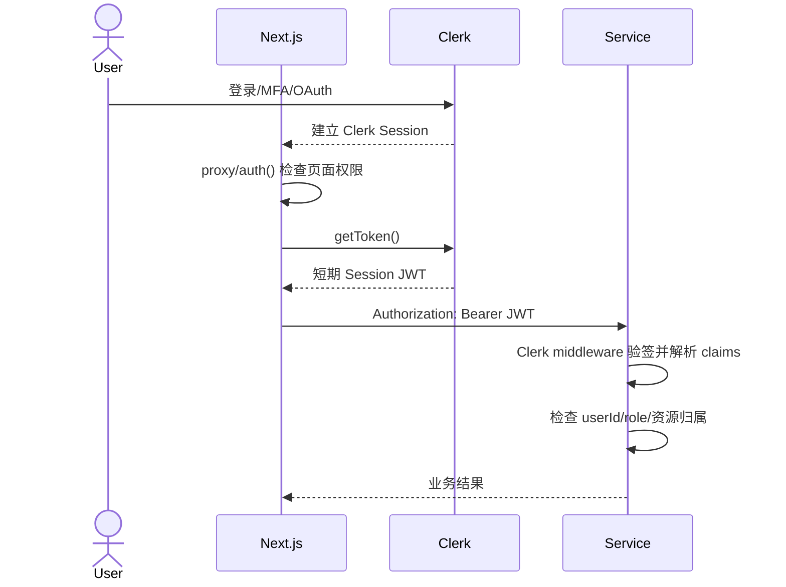

# 02｜Clerk 认证授权与自研方案

## 学习目标

- 区分认证（你是谁）与授权（你能做什么）。
- 讲清项目从 Next.js 到四个后端服务的鉴权链路。
- 对比 Clerk 与自研方案，并能设计 NestJS 认证模块。
- 回答 Session、JWT、Refresh Token、RBAC 与常见安全问题。

建议耗时：**3 小时**。

## 1. 当前项目如何使用 Clerk

### 【当前实现】浏览器与 Next.js

- 两个应用在根布局使用 `ClerkProvider`。
- Client 的 proxy 保护 `/cart`、`/orders` 等路由。
- Admin 的 proxy 除登录/未授权页外均要求登录，并检查 `sessionClaims.metadata.role === 'admin'`。
- Server Component 通过 `auth()` 读取会话并调用 `getToken()`。
- Client Component 通过 `useAuth().getToken()` 获取 Token。

### 【当前实现】后端服务

| 服务            | SDK/入口                  | 授权方式                                   |
| --------------- | ------------------------- | ------------------------------------------ |
| Express Product | `@clerk/express`          | `getAuth(req)`；管理员写接口检查 role      |
| Fastify Order   | `@clerk/fastify`          | `getAuth(request)`；用户只能查自己的订单   |
| Hono Payment    | `@hono/clerk-auth`        | 从 Context 取 auth；创建 Checkout 要求登录 |
| NestJS Auth     | `clerkMiddleware` + Guard | `ShouldBeAdminGuard` 保护用户管理接口      |



### 两层保护为什么都要有

- Next.js 路由保护：尽早重定向，避免用户看到不该访问的 UI。
- 后端授权：真正的安全边界。攻击者可以绕过页面直接调用 API。
- 资源级授权：只验证“已登录”仍不够，例如查询订单必须限制 `userId === 当前用户`。

## 2. Clerk 与自研认证对比

| 维度       | Clerk                                    | 自研                                       |
| ---------- | ---------------------------------------- | ------------------------------------------ |
| 上线速度   | 登录、注册、OAuth、MFA、会话 UI 快速可用 | 从数据模型、安全流程到 UI 全部建设         |
| 安全维护   | 漏洞、Token 轮换、风控由平台持续维护     | 团队承担密码、会话、攻击防护与审计         |
| 定制能力   | 常见场景强，深度流程受产品边界限制       | 数据、流程、协议完全可控                   |
| 成本       | 随 MAU/功能增长，受定价影响              | 初期研发高，长期还有运维与安全成本         |
| 合规与数据 | 需评估供应商地区、DPA、数据驻留          | 可按内部合规部署，但责任全部自担           |
| 可用性     | 依赖第三方控制面和 SDK                   | 依赖自己的架构与值班能力                   |
| 锁定与迁移 | 用户 ID、metadata、SDK 形成耦合          | 接口可控，但内部系统也可能形成技术债       |
| 适合       | 快速产品、标准账号体系、小团队           | 强定制、严格合规、大规模成本可控、既有 IAM |

### 选择原则

不要只算 SaaS 账单，要算总拥有成本：开发、渗透测试、漏洞响应、邮件/短信、MFA、OAuth 兼容、账号恢复、审计和 7×24 可用性。

**【面试表达】**

> 项目目标是验证电商全链路而不是重复造身份系统，所以用 Clerk 降低认证安全与 UI 成本，把精力放在资源授权、支付和服务协作上。它的代价是供应商锁定、成本和深度定制限制。如果公司有数据驻留要求、复杂组织权限或已有 IAM，我会通过内部 Auth Adapter 隔离业务代码，再逐步迁移到自研或企业身份平台。

## 3. Session、Cookie 与 JWT

### Cookie 不是 Session，JWT 也不是登录方案

- Cookie：浏览器保存和发送数据的机制，可承载 session ID 或 Token。
- Server Session：服务端保存会话状态，Cookie 通常只存随机 ID。
- JWT：自包含、签名的 Token 格式；默认不可撤销，也不会自动安全。

| 方案                     | 优势                                  | 劣势                                     |
| ------------------------ | ------------------------------------- | ---------------------------------------- |
| Session ID + 服务端存储  | 易撤销、Token 小、权限变更即时        | 需要共享会话存储；每次查 Session         |
| 短期 Access JWT          | 服务验证快，适合多服务                | 到期前难撤销；claims 可能陈旧；泄露风险  |
| Access + Refresh Session | Access 短期、Refresh 可撤销，兼顾扩展 | 流程更复杂，需要轮换、复用检测和设备管理 |

### 推荐的 Web 自研组合

- Access Token：5～15 分钟，JWT，最小 claims。
- Refresh Token：高熵随机值，放 `HttpOnly + Secure + SameSite` Cookie。
- 服务端只存 Refresh Token 哈希、family、设备、过期时间和撤销状态。
- 每次刷新都轮换；旧 Token 再次出现表示可能被盗，撤销整组 session family。
- 浏览器内存保存 Access Token，或者采用 BFF，让浏览器只持有 HttpOnly Session Cookie。

## 4. JWT 面试必会

JWT = `header.payload.signature`。签名保证内容未被篡改，不代表内容加密；不要放密码、隐私或大量变化数据。

验证至少包括：

- 签名算法白名单，拒绝 `none` 和算法混淆；
- `exp`、`nbf`、`iat`；
- `iss`（签发者）、`aud`（受众）；
- `sub`（主体）、`jti`（Token ID）；
- JWKS Key ID 与密钥轮换；
- 允许很小的时钟偏差；
- HTTPS 和日志脱敏。

### JWT 如何退出登录？

JWT 本身在过期前仍有效。常见方案：

1. Access Token 足够短期；
2. 撤销服务端 Refresh Session，阻止继续刷新；
3. 高风险操作查询 session/version 或 denylist；
4. 用户修改密码/角色时提升 `tokenVersion`，拒绝旧版本；
5. 紧急吊销可用 Redis 保存 `jti` denylist，TTL 等于剩余有效期。

## 5. RBAC、ABAC 与资源授权

- RBAC：用户拥有角色，角色拥有权限。适合 admin/user、运营/客服/财务。
- Permission-based：代码检查 `product:create`，比到处写 `role === admin` 更可演进。
- ABAC：结合用户、资源、环境属性，如“订单属于本人”或“客服只能查看所属区域”。

推荐模式：

```ts
@RequirePermissions('product:create')
@Post()
createProduct(@Body() dto: CreateProductDto) {}
```

Guard 负责身份和粗粒度权限，业务 Service 仍需检查资源所有权与领域规则。

### 当前项目的改进点

- `metadata.role` 只有 user/admin，适合演示，真实后台建议 permissions。
- 四个服务重复定义 `shouldBeUser/shouldBeAdmin`，容易产生不一致。可提取共享 authorization policy 包，但不要把框架 request 类型强耦合进去。
- 角色变更后旧 Token claims 可能暂时陈旧；高风险操作可查询权威权限源或使用短 Token。
- 前台 proxy 只匹配特定路由，新私有页面若忘记加入会暴露 UI；后端仍必须默认拒绝。

## 6. 常见 Web 安全问题

### XSS

攻击脚本读取可访问的 Token 或以用户身份发请求。措施：输出转义、避免不可信 `dangerouslySetInnerHTML`、CSP、依赖治理；HttpOnly 可减少 Token 被直接读取，但不能阻止脚本发起同源操作。

### CSRF

浏览器自动携带 Cookie 时，恶意站点诱导用户发请求。措施：SameSite、CSRF Token、Origin/Referer 校验；Bearer Header 不会由浏览器跨站自动添加，但 Token 存 localStorage 会扩大 XSS 风险。

### CORS

CORS 是浏览器读响应策略，不是认证。服务端必须鉴权；`Access-Control-Allow-Origin` 不应在携带凭证时使用 `*`。

### 密码与账号安全

- 使用 Argon2id；也可用成本合适的 bcrypt，绝不能明文或通用哈希。
- 每个密码独立 salt；pepper 可放密钥管理系统。
- 登录、注册、找回密码都要限流且防账号枚举。
- MFA、异常登录通知、审计日志和恢复码需要完整设计。

## 7. NestJS 自研认证参考架构

### 数据模型

```text
users
  id, email(unique), password_hash, status, token_version,
  email_verified_at, created_at, updated_at

roles / permissions / user_roles / role_permissions

auth_sessions
  id, user_id, refresh_token_hash, family_id, expires_at,
  revoked_at, replaced_by, user_agent, ip, created_at, last_seen_at

auth_audit_logs
  id, user_id, action, result, ip, user_agent, metadata, created_at
```

### 模块边界

```text
AuthModule
├── AuthController       login / refresh / logout / logout-all
├── AuthService          校验密码、签发与轮换 Token
├── AccessTokenStrategy  验证签名与标准 claims
├── JwtAuthGuard         建立 request.user
├── PermissionsGuard     读取 decorator metadata
└── SessionRepository    管理可撤销 Refresh Session

UsersModule              用户资料、密码状态
AuthorizationModule      role/permission/policy
AuditModule              安全审计
```

### 登录流程

1. `ValidationPipe` 校验 DTO。
2. 按 email 查询用户，使用 Argon2 验证密码。
3. 检查账号状态与限流；失败返回统一文案，避免枚举。
4. 创建 session family，保存 Refresh Token 哈希。
5. 返回短期 Access Token；Refresh Token 写入安全 Cookie。
6. 写审计日志，但不记录原始 Token/密码。

### 刷新流程

1. 哈希传入 Refresh Token 并查 session。
2. 检查过期、撤销、用户状态和 Token version。
3. 在数据库事务中撤销旧 session，创建同 family 新 session。
4. 若已撤销 Token 被复用，撤销整个 family 并要求重新登录。

## 8. Clerk 迁移与解耦

业务层不要到处直接依赖 Clerk User 类型。定义内部身份接口：

```ts
export interface AuthPrincipal {
  userId: string
  roles: string[]
  permissions: string[]
  sessionId?: string
}
```

每个框架的 Clerk adapter 只负责把 SDK 结果转换成 `AuthPrincipal`。迁移时替换 adapter，而不是重写所有业务 Service。

## 9. 高频面试题

### 为什么不能只在 Admin 前端判断角色？

> 前端代码和请求都可被用户修改。前端判断只用于导航和体验；后端写接口必须验证 Token、权限和资源条件。项目中 Admin proxy 与每个服务的管理员 middleware/guard 是两层防线。

### Access Token 为什么要短，Refresh Token 为什么要存服务端？

> Access Token 泄露后的有效窗口应尽可能短；Refresh Token 生命周期长且用于续期，所以必须可撤销、可轮换、可检测复用。服务端存哈希而不是明文，可降低数据库泄露后的直接利用风险。

### API Gateway 验证过 Token，服务还要验证吗？

> 网关可以统一认证、限流和基础 claims，但服务仍需做业务授权，尤其是资源归属。如果内部网络不能完全可信，还应验证网关签名的身份上下文或再次验 Token，避免绕过网关直接访问服务。

## 10. 自测清单

- [ ] 从登录开始画出 Clerk Token 到四个服务的路径。
- [ ] 解释认证、角色授权、资源授权的差别。
- [ ] 说出 Clerk 与自研各 5 个权衡点。
- [ ] 解释 JWT 为何不能天然撤销。
- [ ] 画出 Refresh Token 轮换和复用检测。
- [ ] 解释 XSS、CSRF、CORS 各自解决什么问题。
- [ ] 设计 NestJS Guard + permissions decorator。

## 参考资料

- [Clerk：How Clerk works](https://clerk.com/docs/guides/how-clerk-works/overview)
- [Clerk：Next.js auth()](https://clerk.com/docs/reference/nextjs/app-router/auth)
- [Clerk：Session tokens](https://clerk.com/docs/guides/sessions/session-tokens)
- [Clerk：Customize session token](https://clerk.com/docs/guides/sessions/customize-session-tokens)
- [NestJS：Authentication](https://docs.nestjs.com/security/authentication)
- [NestJS：Authorization](https://docs.nestjs.com/security/authorization)
- [OWASP：Authentication Cheat Sheet](https://cheatsheetseries.owasp.org/cheatsheets/Authentication_Cheat_Sheet.html)
- [OWASP：Session Management Cheat Sheet](https://cheatsheetseries.owasp.org/cheatsheets/Session_Management_Cheat_Sheet.html)
- [OWASP：OAuth 2.0 Cheat Sheet](https://cheatsheetseries.owasp.org/cheatsheets/OAuth2_Cheat_Sheet.html)
