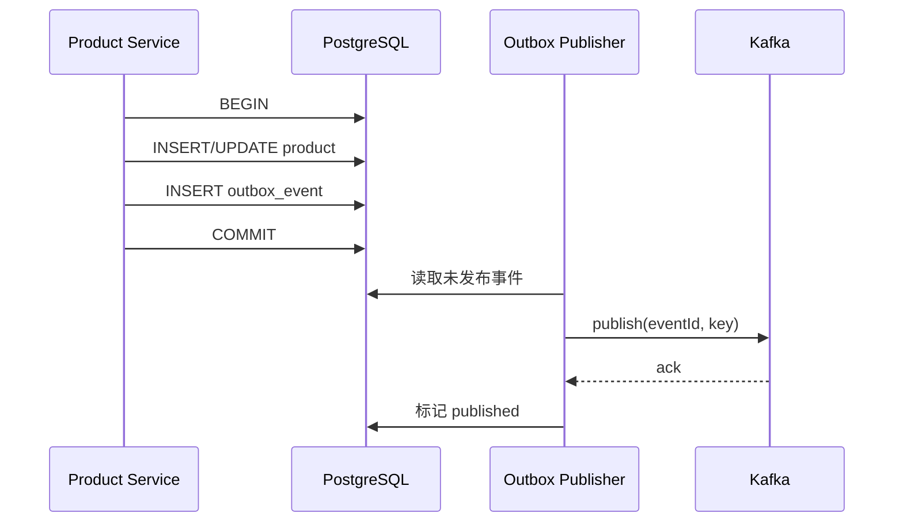

# 05｜Kafka 事件驱动与可靠性

> **当前分支校对 · 2026-09-25：** 当前主链路使用两个目录 topic 和 `payment.order.lifecycle` / `order.payment.applied`。原先直接发布事件的双写风险是改造动机；当前边界与剩余缺口见第 4～5 节。

## 学习目标

- 讲清 Topic、Partition、Consumer Group、Offset 和 Rebalance。
- 理解消息顺序、三种交付语义和“Exactly-once”的边界。
- 能说明项目已有的幂等、数据库重试、事件契约与事务 Outbox，以及待补的独立 retry topic/DLQ。
- 能分析支付成功后订单未创建、重复创建等故障。

建议耗时：**2.5 小时**。

## 1. 当前项目的 Kafka 拓扑

### 基础设施

`packages/kafka/docker-compose.yml` 启动 3 个 Kafka 节点，使用 KRaft 模式，并提供 Kafka UI。客户端连接 `localhost:9094/9095/9096`。

注意：有 3 个 Broker 不代表每个 Topic 一定有 3 副本；副本因子、分区数、`min.insync.replicas` 等需在 Topic/集群配置中明确。

### 事件流

#### 【当前实现】事件拓扑

| Topic                            | Producer                  | Consumer                        | 可靠性边界                                                          |
| -------------------------------- | ------------------------- | ------------------------------- | ------------------------------------------------------------------- |
| `catalog.product.sync.requested` | Product Outbox dispatcher | Payment catalog consumer        | Product ID 为 key；版本化 UPSERT/ARCHIVE；Payment Inbox 去重        |
| `catalog.product.sync.result`    | Payment Outbox dispatcher | Product catalog result consumer | Product ID 为 key；仅同版本结果可更新状态                           |
| `payment.order.lifecycle`        | Payment Outbox dispatcher | Order Payment Inbox             | `orderId` 为 key；完整快照；event ID 去重；aggregate version 防乱序 |
| `order.payment.applied`          | Order Outbox dispatcher   | Payment Ack Inbox               | `orderId` 为 key；确认已应用版本和 Order 是否存在                   |

共享包 `@repo/kafka` 封装 `createKafkaClient/createProducer/createConsumer`。旧 `product.created` / `product.deleted` 常量仍在 `constants.ts`，但不承担当前主链路；`payment.successful` 已不是当前 topic。Catalog 事件有 `eventId`、商品 ID/版本、操作和期望快照，尚无独立 schema version；Payment/Order envelope 已有 `schemaVersion: 1`、event ID、aggregate version、correlation/causation ID。当前仍用 JSON，没有 Schema Registry/契约兼容 CI。

## 2. 核心模型

### Event、Topic、Partition

- Event 是追加到日志的记录，通常包含 key、value、timestamp、headers。
- Topic 是事件类别。
- Topic 被拆为 Partition，以获得并行与可扩展日志。
- **顺序只保证在单个 partition 内**，不保证 Topic 全局顺序。

### Message Key

相同 key 通常路由到相同 partition，因此同一业务实体可保持相对顺序。例如商品事件用 `productId`，订单事件用 `orderId`。

Producer 支持可选 message key。两个 catalog topic 用 `productId`，支付生命周期和 Ack 用 `orderId`。同实体通常进入同一 partition，但正确性仍不只依赖到达顺序：目录结果检查版本与 revision，Order 投影检查 aggregate version。

### Replica、Leader、ISR

- 每个 partition 有 leader，生产和消费主要经过 leader。
- follower 复制日志。
- ISR 是与 leader 保持足够同步的副本集合。
- `acks=all` 配合合理副本因子和 `min.insync.replicas` 才能提高持久性；任一项单独存在都不完整。

### Consumer Group

同一 group 内，一个 partition 同时只分配给一个 consumer；增加 consumer 直到超过 partition 数后，多出的 consumer 空闲。不同 group 各自消费完整 Topic，适合不同业务订阅者。

本项目 Payment Service 和 Order Service 使用独立 group。若同一个服务启动多个实例，它们会在各自 group 内分摊 partition。

### Offset

Offset 是 consumer group 在每个 partition 的消费位置。提交 offset 表示“这之前的消息已被处理”。最关键的问题是：**业务副作用与 offset 提交的先后顺序**。

### Rebalance

实例加入/离开、订阅变化或超时可能触发 partition 重新分配。处理中的消息可能被另一个实例再次获取，所以消费者必须幂等。长任务需关注 heartbeat、session timeout 和 `max.poll.interval` 对应客户端配置。

## 3. 三种交付语义

### At-most-once

先提交 offset，再处理业务。崩溃时消息可能丢，但通常不重复。

### At-least-once

业务成功后再提交 offset。崩溃可能导致重放，因此不丢的代价是可能重复。多数业务系统以此为基础 + 幂等消费者。

### Exactly-once

“严格只发生一次”必须说明范围。Kafka 的幂等 producer 避免 producer retry 在同一 partition 写入重复；Kafka transaction 可原子写多个 Kafka partition 并提交消费 offset，Kafka Streams 能简化 Kafka-to-Kafka exactly-once。

但若副作用是 Stripe、邮件或外部数据库，Kafka 事务无法自动让它们只执行一次。仍需外部幂等键、唯一约束、状态机或 Outbox/Inbox。

**【面试表达】**

> 我不会笼统承诺端到端 exactly-once。项目采用 at-least-once + 幂等：Stripe Webhook 用 `event.id` 入 Payment Inbox，支付状态与 Outbox 同事务；Order 把 event ID Inbox、全快照投影和 Ack Outbox 放进 Mongo transaction。Kafka 重放或 worker 崩溃后可重试，旧版本不会覆盖新状态。

## 4. Producer 可靠性

关键配置/概念：

- `acks=0`：不等待，吞吐高但可能丢。
- `acks=1`：leader 写入即确认，leader 未复制就故障仍可能丢。
- `acks=all`：等待 ISR 确认，配合副本与 `min.insync.replicas`。
- `enable.idempotence`：producer retry 时避免同一 partition 重复写入；需满足相关 acks/retry/in-flight 条件，具体看客户端默认值。
- Retry：只重试瞬时错误，并设置指数退避与上限；永久验证错误不应无限重试。
- Delivery timeout：避免请求无限等待。

### 当前项目落地

Product 写操作与 Product Outbox 同事务；Stripe Webhook 先落 Payment Inbox 再返回 2xx；支付状态与 Payment Outbox 同事务；Order Inbox、订单投影与 Ack Outbox 使用 Mongo transaction。`await producer.send(...)` 本身无法消除本地数据库与 Kafka 的双写窗口，Outbox worker 在发送成功、标记已发布前崩溃时仍会重发，所以消费端仍须幂等。

## 5. Consumer 可靠性与幂等

### 【当前实现】消费与剩余边界

- `fromBeginning: true`：新 group 会从最早消息读取；生产误换 group ID 可能重放历史。`eachMessage` 使用 KafkaJS 的自动 offset 管理，因此 handler 成功返回前先要持久化 Inbox。
- `packages/kafka/src/consumer.ts` 默认 `errorPolicy: 'skip'` 会记录并吞掉异常；**当前目录、生命周期与 Ack 订阅均显式设置 `errorPolicy: 'retry'`**，数据库持久化失败会重抛，避免误提交 offset。新增订阅时必须显式选择策略。
- Order 对坏 JSON/坏契约持久化 `RejectedPaymentEvent`，成功留存后跳过；写 rejected record 失败仍重试。Payment 的已解析无效 Catalog/Ack 载荷，以及 Product 的无效目录结果，目前主要记录日志后跳过；目录 topic 没有 `invalidMessageHandler`，无法解析的 JSON 会抛错重试并可能阻塞分区。它们尚无统一的持久化隔离与人工处理入口。
- 合法事件分别按 Catalog event ID、Payment lifecycle event ID 或 Ack event ID 去重，业务处理交给可 lease 重领的 worker；失败任务保存在数据库并可受控重置。尚无独立 retry topic/DLQ。

### 幂等消费者模式

通用设计示例（当前 Payment/Order 的实际契约见 `packages/types/src/payment-order.ts`；Catalog 契约见 `catalog-sync.ts`）：

```ts
type IntegrationEvent<T> = {
  id: string
  type: string
  version: number
  occurredAt: string
  aggregateId: string
  correlationId?: string
  data: T
}
```

数据库建立 `processed_events(event_id unique, consumer, processed_at)`。在同一事务中：

1. 插入 processed event；唯一冲突表示已处理，安全返回。
2. 执行业务写入。
3. 提交事务。
4. 事务成功后才允许提交 Kafka offset。

如果业务与幂等记录不在同一数据库事务中，仍有崩溃窗口。

### 自然幂等

- Stripe 创建商品使用稳定 product ID，可配合查询/更新策略。
- 支付入口以 Stripe `event.id` 入 Inbox；`CheckoutAttempt` 对 user/key、order ID 和 Stripe IDs 建唯一约束；Order 对 order/attempt/session ID 建唯一索引。
- 删除不存在资源可视为成功。

自然幂等比“先查再写”可靠；并发下最终由唯一约束裁决。

## 6. Retry 与 DLQ

### 错误分类

- 瞬时错误：网络超时、依赖 503、数据库短暂不可用 → 重试。
- 永久错误：schema 不兼容、必填字段缺失、资源永久不存在 → 不应无限重试。
- 不确定错误：第三方请求超时但可能成功 → 先用幂等 key 查询结果，再决定重试。

### 重试策略

不要在 consumer 内无限快速 retry 阻塞 partition。常见方式：

```text
payment.order.lifecycle
  → payment.order.lifecycle.retry.1m
  → payment.order.lifecycle.retry.10m
  → payment.order.lifecycle.dlq
```

记录 `attempt`、原 topic/partition/offset、异常类型和时间。DLQ 需要告警、查看、修复与安全重放工具；有 DLQ 不等于问题被解决。

### 顺序与重试冲突

把失败消息放入 retry topic 后，原 partition 后续消息可能继续，破坏实体顺序。对强顺序状态机可：

- 用 aggregate version 拒绝过期事件；
- 暂停 partition 并有限重试；
- 让消费者按当前权威状态做幂等状态转换；
- 设计补偿/对账，而不是依赖“绝对永不乱序”。

## 7. 事务 Outbox

### 解决的问题

商品写 PostgreSQL 成功，但 Kafka 发送失败。因为数据库事务与 Kafka 不共享一个原子提交，这叫 dual-write 问题。

### 流程



Publisher 可轮询，也可用 CDC（如 Debezium）捕获 WAL/change log。即使 Kafka 发送成功，Publisher 在标记前崩溃仍会重发，所以 consumer 幂等不可省。

### Inbox/Outbox 边界

- Outbox：保证“本地业务提交后，事件最终会被发布”。
- Inbox/processed events：保证“重复事件不会重复产生业务副作用”。
- 对账：处理极端故障、人工操作和第三方长期不一致。

## 8. Event Contract 与演进

- Topic 名称表达业务事实，优先 past tense：`payment.completed`，不是命令式 `create-order`。
- Envelope 包含 id、version、occurredAt、aggregateId、correlationId。
- Schema 使用 JSON Schema/Avro/Protobuf 并做兼容检查。
- 新增可选字段通常向后兼容；删除/改类型风险高。
- 消费者不应直接依赖生产者内部数据库 Entity。
- 敏感信息最小化；Kafka retention 会让数据长期存在。

当前 `payment.order.lifecycle` 全快照含 email、shipping 等个人信息，生产环境需评估最小化、加密、访问控制、保留期与日志脱敏。

## 9. 运行与可观测性

关注指标：

- consumer lag 与 lag 增长率；
- publish/consume 成功率和延迟；
- retry/DLQ 数量；
- rebalance 次数与耗时；
- handler 耗时、数据库/Stripe 错误；
- broker 磁盘、under-replicated partitions、ISR 变化。

优雅停机：停止接收新请求 → 停止 worker interval → 等待/中止当前 handler → disconnect consumer/producer → 关闭数据库。Payment 与 Order Service 当前已注册 SIGINT/SIGTERM shutdown；仍可继续增强超时上限和运行中任务 drain 指标。

## 10. 当前项目的改进优先级

> 完成标记只代表当前分支代码，不代表生产环境已完成迁移、故障演练和 Stripe Test Mode 冒烟。

### P0：正确性

1. [x] Catalog 事件加入唯一 event ID、商品 ID、商品版本和 message key；独立 schema version 仍待补充。
2. [x] Catalog 发布由 Outbox dispatcher 等待结果并持久化错误，不静默丢失。
3. [x] Webhook 以 Stripe event ID 去重，Order Inbox/Order 唯一索引建立幂等边界。
4. [x] lifecycle consumer 数据库失败重抛；坏消息持久化 rejected record 后跳过。

### P1：一致性与恢复

1. [x] Product + Product Outbox 同事务，Payment Inbox/ledger 同事务，Catalog result 使用 Payment Outbox。
2. [x] 商品/Stripe 自动与手动对账、失败任务重置和管理员状态查询。
3. [x] Order Consumer 使用 PaymentEventInbox event ID 唯一约束和 paymentVersion fence。
4. [x] Payment → Order Webhook Inbox、Payment Outbox、Order Inbox/transaction/Outbox、Ack 与跨账本对账。
5. [ ] Payment → Order Retry topics + DLQ + 指标告警；当前使用数据库 FAILED/rejected 记录和管理员重试。
6. [x] Stripe payment / Payment DB / Order MongoDB 定期对账。

### P2：治理

1. Schema Registry/契约 CI。
2. correlation ID 与 OpenTelemetry trace。
3. 明确 topic partition、replication、retention 和 ACL。
4. 容量测试与故障演练。

## 11. 高频面试题

### Kafka 如何保证消息顺序？

> Kafka 只保证单 partition 内顺序。生产者用业务实体 ID 做 key，使同一实体进入同一 partition；消费者组内一个 partition 同时给一个 consumer。重试、并发 handler 和跨 partition 都可能破坏业务观察顺序，所以还需 event version 与幂等状态机。

### 消费者写数据库成功但 offset 未提交会怎样？

> 重启后消息会再次投递。当前 Order Inbox 对 event ID 建唯一索引，Order 对 order/attempt/session ID 建唯一索引，并以 aggregate version 拒绝旧快照；重复投递可安全识别。若缺少这些约束，at-least-once 的重放窗口就可能产生重复订单。

### 为什么有 Kafka 事务还需要 Outbox？

> Kafka 事务能原子处理 Kafka 内的生产与消费 offset，但不能把普通 PostgreSQL 业务事务或 Stripe 调用纳入同一个原子提交。Outbox 把业务数据和待发布事件放进同一本地数据库事务，再异步发布。

## 12. 自测清单

- [ ] 画出四个当前 Topic 的生产者、消费者和 Inbox/Outbox，并说明遗留 product topic 的状态。
- [ ] 解释 partition、key、consumer group 和 offset。
- [ ] 对比三种交付语义，说明 exactly-once 范围。
- [ ] 解释 `errorPolicy: 'retry'`、默认 `skip` 与坏消息留存策略的区别。
- [ ] 设计 payment event 幂等表/唯一索引。
- [ ] 画出 Outbox 与重试/DLQ 流程。
- [ ] 说出 6 个 Kafka 生产指标。

## 参考资料

- [Apache Kafka：Introduction](https://kafka.apache.org/documentation/#intro_concepts_and_terms)
- [Apache Kafka：Design](https://kafka.apache.org/documentation/#design)
- [Apache Kafka：Producer Configs](https://kafka.apache.org/documentation/#producerconfigs)
- [KafkaJS：Producing Messages](https://kafka.js.org/docs/producing)
- [KafkaJS：Consuming Messages](https://kafka.js.org/docs/consuming)
- [Debezium：Outbox Event Router](https://debezium.io/documentation/reference/stable/transformations/outbox-event-router.html)
