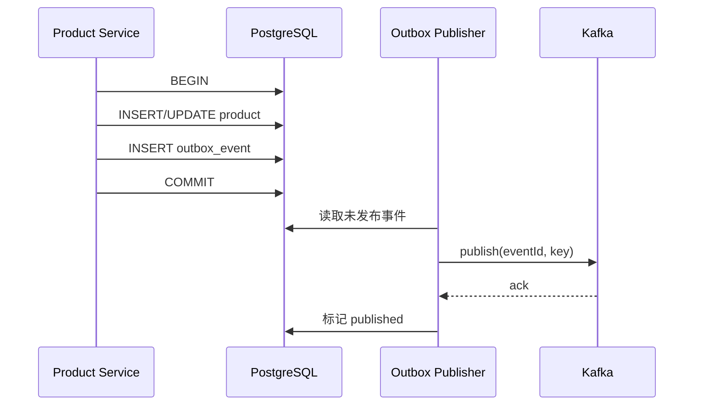

# 05｜Kafka 事件驱动与可靠性

> **Reliability Update · 2026-08-24**
>
> 商品目录 Kafka 链路已经完成可靠性改造；本章保留旧 topic 和失败窗口作为 before 基线。`payment.successful` 的 Webhook → Order 链路仍使用旧策略，不能把商品目录侧的完成项外推到整个支付系统。

## 学习目标

- 讲清 Topic、Partition、Consumer Group、Offset 和 Rebalance。
- 理解消息顺序、三种交付语义和“Exactly-once”的边界。
- 能为项目补幂等、重试、DLQ、事件契约与事务 Outbox。
- 能分析支付成功后订单未创建、重复创建等故障。

建议耗时：**2.5 小时**。

## 1. 当前项目的 Kafka 拓扑

### 基础设施

`packages/kafka/docker-compose.yml` 启动 3 个 Kafka 节点，使用 KRaft 模式，并提供 Kafka UI。客户端连接 `localhost:9094/9095/9096`。

注意：有 3 个 Broker 不代表每个 Topic 一定有 3 副本；副本因子、分区数、`min.insync.replicas` 等需在 Topic/集群配置中明确。

### 事件流

#### 原始拓扑（改造前/遗留链路）

| Topic                | Producer                | Consumer        | 作用                         |
| -------------------- | ----------------------- | --------------- | ---------------------------- |
| `product.created`    | Product Service         | Payment Service | 在 Stripe 创建商品和默认价格 |
| `product.deleted`    | Product Service         | Payment Service | 删除 Stripe 商品             |
| `payment.successful` | Payment Service Webhook | Order Service   | 在 MongoDB 创建订单          |

共享包 `@repo/kafka` 封装 `createKafkaClient/createProducer/createConsumer`。事件当前使用 JSON，无 schema registry 和显式版本。

#### Reliability Update · 2026-08-24（当前商品目录拓扑）

| Topic                            | Producer                  | Consumer                        | 可靠性边界                                                             |
| -------------------------------- | ------------------------- | ------------------------------- | ---------------------------------------------------------------------- |
| `catalog.product.sync.requested` | Product Outbox dispatcher | Payment catalog consumer        | Product ID 为 key；版本化 UPSERT/ARCHIVE；Payment Inbox 去重           |
| `catalog.product.sync.result`    | Payment Outbox dispatcher | Product catalog result consumer | Product ID 为 key；仅同版本结果可更新状态                              |
| `payment.successful`             | Payment Service Webhook   | Order Service                   | 遗留订单链路，仍待补 Webhook Inbox、Payment Outbox、Order Inbox 与幂等 |

旧 `product.created` / `product.deleted` 常量仍可能存在于共享契约中，但不再承担当前商品目录同步主链路。Catalog 事件具有 `eventId`、商品 ID、商品版本、操作和完整期望快照；Producer 已支持 message key。独立的事件 schema version 仍属于契约治理待办。

## 2. 核心模型

### Event、Topic、Partition

- Event 是追加到日志的记录，通常包含 key、value、timestamp、headers。
- Topic 是事件类别。
- Topic 被拆为 Partition，以获得并行与可扩展日志。
- **顺序只保证在单个 partition 内**，不保证 Topic 全局顺序。

### Message Key

相同 key 通常路由到相同 partition，因此同一业务实体可保持相对顺序。例如商品事件用 `productId`，订单事件用 `orderId`。

原始 `@repo/kafka` 只发送 `value`，没有 key。分区数大于 1 时，同一商品的 created/deleted 事件不一定进入同一分区，顺序无法依赖。

**Reliability Update · 2026-08-24：** Producer 现在支持可选 message key，两个 catalog topic 都使用 `productId`。这提供同商品分区内相对顺序，但正确性仍不依赖顺序：Payment ledger 和 Product 结果消费者都用版本条件拒绝过期事件。

### Replica、Leader、ISR

- 每个 partition 有 leader，生产和消费主要经过 leader。
- follower 复制日志。
- ISR 是与 leader 保持足够同步的副本集合。
- `acks=all` 配合合理副本因子和 `min.insync.replicas` 才能提高持久性；任一项单独存在都不完整。

### Consumer Group

同一 group 内，一个 partition 同时只分配给一个 consumer；增加 consumer 直到超过 partition 数后，多出的 consumer 空闲。不同 group 各自消费完整 Topic，适合不同业务订阅者。

本项目 Payment Service 和 Order Service 使用独立 group。若同一个服务启动多个实例，它们会在各自 group 内分摊 partition。

### Offset

Offset 是 consumer group 在每个 partition 的消费位置。提交 offset 表示“这之前的消息已被处理”。最关键的问题是：**业务副作用与 offset 提交的先后顺序**。

### Rebalance

实例加入/离开、订阅变化或超时可能触发 partition 重新分配。处理中的消息可能被另一个实例再次获取，所以消费者必须幂等。长任务需关注 heartbeat、session timeout 和 `max.poll.interval` 对应客户端配置。

## 3. 三种交付语义

### At-most-once

先提交 offset，再处理业务。崩溃时消息可能丢，但通常不重复。

### At-least-once

业务成功后再提交 offset。崩溃可能导致重放，因此不丢的代价是可能重复。多数业务系统以此为基础 + 幂等消费者。

### Exactly-once

“严格只发生一次”必须说明范围。Kafka 的幂等 producer 避免 producer retry 在同一 partition 写入重复；Kafka transaction 可原子写多个 Kafka partition 并提交消费 offset，Kafka Streams 能简化 Kafka-to-Kafka exactly-once。

但若副作用是 Stripe、邮件或外部数据库，Kafka 事务无法自动让它们只执行一次。仍需外部幂等键、唯一约束、状态机或 Outbox/Inbox。

**【面试表达】**

> 我不会笼统承诺端到端 exactly-once。项目更适合 at-least-once + 幂等：支付事件带唯一 eventId，订单库建立唯一索引；重复消费先查处理记录或用唯一插入阻止重复副作用，成功后再提交 offset。

## 4. Producer 可靠性

关键配置/概念：

- `acks=0`：不等待，吞吐高但可能丢。
- `acks=1`：leader 写入即确认，leader 未复制就故障仍可能丢。
- `acks=all`：等待 ISR 确认，配合副本与 `min.insync.replicas`。
- `enable.idempotence`：producer retry 时避免同一 partition 重复写入；需满足相关 acks/retry/in-flight 条件，具体看客户端默认值。
- Retry：只重试瞬时错误，并设置指数退避与上限；永久验证错误不应无限重试。
- Delivery timeout：避免请求无限等待。

### 当前项目风险

Product Controller 和 Stripe Webhook 调用 `producer.send(...)` 时没有 `await`。HTTP 已返回或进程崩溃时，发送失败可能不被业务感知。

仅仅加 `await` 仍不能解决“数据库成功、Kafka 失败”的双写窗口。可靠方案是 Outbox。

> **更新说明：** 上述 Product Controller 风险是改造前基线；当前商品写入与 Product Outbox 已在同一事务，dispatcher 持续重试发布。Stripe Webhook → `payment.successful` 的直接发布风险仍然存在，记录在根目录 [`TODO.md`](../../TODO.md)。

## 5. Consumer 可靠性与幂等

### 当前实现行为

- `fromBeginning: true`：新 group 会从最早消息读取，适合本地演示；生产误换 group ID 可能重放全部历史。
- `eachMessage` 使用默认自动 offset 管理。
- 共享 consumer 捕获 handler 异常后只打印，不再抛出。框架可能认为处理成功并提交 offset，导致失败消息永久跳过。
- `createStripeProduct/deleteStripeProduct` 内部捕获错误并返回 error，也不会触发重试。
- 没有 event ID、幂等表、唯一约束、重试 Topic 或 DLQ。

> **Reliability Update · 2026-08-24：** 上述行为仍描述共享的遗留订单 consumer。Catalog consumer 使用单独的“异常重抛”策略，并先以数据库事务持久化 Inbox/ledger，再提交 offset；Stripe 外部调用交给可 lease 重领的 worker。worker 对网络错误、429、5xx 有限退避重试，对永久错误立即失败；结果由第二个 Outbox 可靠发布。Catalog 路径已经有 event ID、唯一约束和版本幂等，但尚未引入 retry topic/DLQ。

### 幂等消费者模式

事件 envelope：

```ts
type IntegrationEvent<T> = {
  id: string
  type: string
  version: number
  occurredAt: string
  aggregateId: string
  correlationId?: string
  data: T
}
```

数据库建立 `processed_events(event_id unique, consumer, processed_at)`。在同一事务中：

1. 插入 processed event；唯一冲突表示已处理，安全返回。
2. 执行业务写入。
3. 提交事务。
4. 事务成功后才允许提交 Kafka offset。

如果业务与幂等记录不在同一数据库事务中，仍有崩溃窗口。

### 自然幂等

- Stripe 创建商品使用稳定 product ID，可配合查询/更新策略。
- 支付订单以 `stripeEventId` 或 `checkoutSessionId` 建唯一索引。
- 删除不存在资源可视为成功。

自然幂等比“先查再写”可靠；并发下最终由唯一约束裁决。

## 6. Retry 与 DLQ

### 错误分类

- 瞬时错误：网络超时、依赖 503、数据库短暂不可用 → 重试。
- 永久错误：schema 不兼容、必填字段缺失、资源永久不存在 → 不应无限重试。
- 不确定错误：第三方请求超时但可能成功 → 先用幂等 key 查询结果，再决定重试。

### 重试策略

不要在 consumer 内无限快速 retry 阻塞 partition。常见方式：

```text
payment.successful
  → payment.successful.retry.1m
  → payment.successful.retry.10m
  → payment.successful.dlq
```

记录 `attempt`、原 topic/partition/offset、异常类型和时间。DLQ 需要告警、查看、修复与安全重放工具；有 DLQ 不等于问题被解决。

### 顺序与重试冲突

把失败消息放入 retry topic 后，原 partition 后续消息可能继续，破坏实体顺序。对强顺序状态机可：

- 用 aggregate version 拒绝过期事件；
- 暂停 partition 并有限重试；
- 让消费者按当前权威状态做幂等状态转换；
- 设计补偿/对账，而不是依赖“绝对永不乱序”。

## 7. 事务 Outbox

### 解决的问题

商品写 PostgreSQL 成功，但 Kafka 发送失败。因为数据库事务与 Kafka 不共享一个原子提交，这叫 dual-write 问题。

### 流程



Publisher 可轮询，也可用 CDC（如 Debezium）捕获 WAL/change log。即使 Kafka 发送成功，Publisher 在标记前崩溃仍会重发，所以 consumer 幂等不可省。

### Inbox/Outbox 边界

- Outbox：保证“本地业务提交后，事件最终会被发布”。
- Inbox/processed events：保证“重复事件不会重复产生业务副作用”。
- 对账：处理极端故障、人工操作和第三方长期不一致。

## 8. Event Contract 与演进

- Topic 名称表达业务事实，优先 past tense：`payment.completed`，不是命令式 `create-order`。
- Envelope 包含 id、version、occurredAt、aggregateId、correlationId。
- Schema 使用 JSON Schema/Avro/Protobuf 并做兼容检查。
- 新增可选字段通常向后兼容；删除/改类型风险高。
- 消费者不应直接依赖生产者内部数据库 Entity。
- 敏感信息最小化；Kafka retention 会让数据长期存在。

当前 `payment.successful` 带 email/address 等个人信息，生产环境需评估加密、访问控制、保留期与日志脱敏。

## 9. 运行与可观测性

关注指标：

- consumer lag 与 lag 增长率；
- publish/consume 成功率和延迟；
- retry/DLQ 数量；
- rebalance 次数与耗时；
- handler 耗时、数据库/Stripe 错误；
- broker 磁盘、under-replicated partitions、ISR 变化。

优雅停机：停止接收新请求 → 停止拉取/等待 handler 完成 → 提交正确 offset → disconnect consumer/producer → 关闭数据库。当前服务没有 signal handler，应补齐。

## 10. 当前项目的改进优先级

> **Reliability Update · 2026-08-24：** 以下清单改为“已完成的商品目录能力 + 尚待完成的支付订单能力”。完成标记只代表当前分支代码，不代表生产环境已完成迁移和 Test Mode 冒烟。

### P0：正确性

1. [x] Catalog 事件加入唯一 ID、aggregate ID、商品版本和 message key；独立 schema version 仍待补充。
2. [x] Catalog 发布由 Outbox dispatcher 等待结果并持久化错误，不静默丢失。
3. [ ] Webhook 与订单库建立唯一幂等键。
4. [ ] `payment.successful` consumer handler 失败进入重试路径，不能吞异常后提交 offset。

### P1：一致性与恢复

1. [x] Product + Product Outbox 同事务，Payment Inbox/ledger 同事务，Catalog result 使用 Payment Outbox。
2. [x] 商品/Stripe 自动与手动对账、失败任务重置和管理员状态查询。
3. [ ] Order Consumer 使用 processed event/唯一约束。
4. [ ] Payment → Order Retry topics + DLQ + 告警与重放工具。
5. [ ] Stripe payment/payment DB/Order MongoDB 定期对账。

### P2：治理

1. Schema Registry/契约 CI。
2. correlation ID 与 OpenTelemetry trace。
3. 明确 topic partition、replication、retention 和 ACL。
4. 容量测试与故障演练。

## 11. 高频面试题

### Kafka 如何保证消息顺序？

> Kafka 只保证单 partition 内顺序。生产者用业务实体 ID 做 key，使同一实体进入同一 partition；消费者组内一个 partition 同时给一个 consumer。重试、并发 handler 和跨 partition 都可能破坏业务观察顺序，所以还需 event version 与幂等状态机。

### 消费者写数据库成功但 offset 未提交会怎样？

> 重启后消息会再次投递。若订单表按 eventId/sessionId 有唯一约束，重复处理可识别并安全返回；没有幂等则可能重复订单。这是 at-least-once 的典型窗口。

### 为什么有 Kafka 事务还需要 Outbox？

> Kafka 事务能原子处理 Kafka 内的生产与消费 offset，但不能把普通 PostgreSQL 业务事务或 Stripe 调用纳入同一个原子提交。Outbox 把业务数据和待发布事件放进同一本地数据库事务，再异步发布。

## 12. 自测清单

- [ ] 画出两个 Catalog Topic 与 `payment.successful` 的生产者和消费者，并说明遗留 product topic 的状态。
- [ ] 解释 partition、key、consumer group 和 offset。
- [ ] 对比三种交付语义，说明 exactly-once 范围。
- [ ] 找出当前 consumer 吞异常的后果。
- [ ] 设计 payment event 幂等表/唯一索引。
- [ ] 画出 Outbox 与重试/DLQ 流程。
- [ ] 说出 6 个 Kafka 生产指标。

## 参考资料

- [Apache Kafka：Introduction](https://kafka.apache.org/documentation/#intro_concepts_and_terms)
- [Apache Kafka：Design](https://kafka.apache.org/documentation/#design)
- [Apache Kafka：Producer Configs](https://kafka.apache.org/documentation/#producerconfigs)
- [KafkaJS：Producing Messages](https://kafka.js.org/docs/producing)
- [KafkaJS：Consuming Messages](https://kafka.js.org/docs/consuming)
- [Debezium：Outbox Event Router](https://debezium.io/documentation/reference/stable/transformations/outbox-event-router.html)
