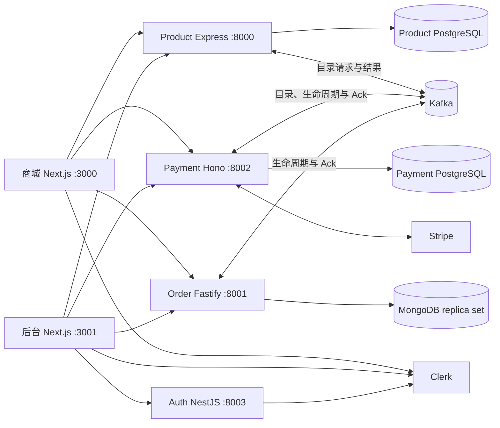

# ECOM-RR 项目总览与迭代规划

> 基于 `feat/catalog-stripe-reliable-sync` 分支，截至 2026-09-25 的代码。本文是回忆项目用的导航图；运行和迁移步骤以 [`migration.md`](../migration.md) 为准，面试练习见 [`interview-preparation/`](./interview-preparation/README.md)。以下“已实现”只表示仓库已有代码，不代表已完成生产部署或故障演练。

> **Update · 2026-09-26：** 增量补充目录对账保护、过期 Checkout 恢复、浏览器 `fetch` 修复及独立 Client 测试命令。长故障恢复和退款失败/取消保留为后续工作；没有因这些修复新增 schema 或迁移。

## 1. 用一分钟找回全貌

这是 pnpm 9 + Turborepo 管理的 TypeScript 电商 Monorepo。`apps/client` 是商城，`apps/admin` 是管理后台；四个后端分别负责商品、订单投影、支付和 Clerk 用户管理。服务通过 HTTP 提供查询与命令，通过 Kafka 传递跨服务事件。商品和支付各有独立 PostgreSQL/Prisma 数据库，订单使用 MongoDB/Mongoose；订单的多文档事务要求 MongoDB 以 replica set 运行。

当前最重要的设计是两条最终一致链路：**Product → Stripe 商品目录**，以及 **Stripe Webhook → Payment → Order → Payment Ack**。共同模式是本地事务 + Outbox、Inbox 去重、可重领 worker、版本栅栏和定期对账。跨数据库、Kafka 和 Stripe 不承诺端到端 exactly-once。



Clerk 负责登录和会话；各服务仍在自己的 HTTP 边界验证身份、管理员角色或订单资源归属。Admin 上传商品图片到 Cloudinary。Redis 尚未接入。

## 2. 目录和职责

| 位置                                                              | 职责                                                             | 从这里读起                                                                                                                              |
| ----------------------------------------------------------------- | ---------------------------------------------------------------- | --------------------------------------------------------------------------------------------------------------------------------------- |
| `apps/client`                                                     | 商品浏览、购物车、Custom Checkout、支付返回页、我的订单          | `src/app/products`、`src/app/cart/page.tsx`、`src/components/CartForm/StripePaymentForm.tsx`、`src/components/PaymentReturnStatus.tsx`  |
| `apps/admin`                                                      | 商品、分类、用户、订单，以及支付订单同步状态与重试入口           | `src/app/(dashboard)`、`src/app/api/payment-sync/route.ts`                                                                              |
| `apps/product-service`                                            | 商品 CRUD、目录版本、Product Outbox、结果回写                    | `src/controllers/product.controller.ts`、`src/utils/productOutboxWorker.ts`、`src/utils/subscriptions.ts`                               |
| `apps/payment-service`                                            | Stripe 目录账本、Checkout、Webhook、支付状态、Outbox、Ack 和对账 | `src/routes/session.route.ts`、`src/routes/webhooks.route.ts`、`src/utils/stripeWebhookWorker.ts`、`src/utils/paymentReconciliation.ts` |
| `apps/order-service`                                              | 消费支付快照，投影订单，发布应用 Ack，提供订单查询               | `src/utils/subscriptions.ts`、`src/utils/orderWorker.ts`、`src/routes/order.ts`                                                         |
| `apps/auth-service`                                               | Clerk 用户查询/修改与管理员 Guard；不是自建密码或 Session 服务   | `src/user`、`src/guards/should-be-admin.guard.ts`                                                                                       |
| `packages/types`                                                  | 跨服务事件契约、商品和订单类型                                   | `src/catalog-sync.ts`、`src/payment-order.ts`                                                                                           |
| `packages/kafka`                                                  | KafkaJS producer/consumer 封装与 topic 名称                      | `src/producer.ts`、`src/consumer.ts`、`src/constants.ts`                                                                                |
| `packages/product-db`、`packages/payment-db`、`packages/order-db` | Product/Payment Prisma schema 与 Mongo 模型                      | 各自的 `prisma/schema.prisma` 或 `src/*-model.ts`                                                                                       |

`packages/eslint-config` 与 `packages/typescript-config` 是工程配置。`turbo.json` 编排 build、dev、类型检查及 Prisma client 生成。根目录 [`README.md`](../README.md) 是启动入口，[`TODO.md`](../TODO.md) 记录可靠性后续工作。

## 3. 关键业务节点

### A. 商品写入到 Stripe 可用于结算

1. 管理员调用 Product 写接口。`product.controller.ts` 在一个 Prisma 事务中更新 `Product.catalogVersion/stripeSyncStatus`，并插入 `ProductOutboxEvent`；删除时写 `ARCHIVE` tombstone。
2. `productOutboxWorker.ts` 认领待发布事件，按 `productId` 作为 Kafka key 发送 `catalog.product.sync.requested`。Payment 的 `subscriptions.ts` 用 event ID 写 `CatalogInboxEvent`，并按版本更新 `StripeCatalogItem` 的期望状态。
3. `catalogWorker.ts` 根据账本执行 Stripe UPSERT/ARCHIVE；`stripeCatalog.ts` 处理 Product/Price，改价会创建新 Price、切换默认 Price 并停用旧 Price。同步结果通过 Payment Outbox 发 `catalog.product.sync.result`，Product 仅接收当前版本且更新 revision 更高的结果。
4. `catalogReconciliation.ts` 对比本地期望与 Stripe 状态；存量商品用 `scripts/backfillCatalogSync.ts` 入队。可售强制开关开启后，Product 公共读取只返回同步版本的商品；后台 `/products/admin` 仍可看全部商品。

**Update · 2026-09-26 · 对账细节：** `catalogDrift.ts` 比较默认 Price ID 与已确认的账本 Price ID，所以相同金额的替换 Price 也会触发重新同步。孤儿归档在开始和每次 Stripe 写入前检查实时账本，不能只使用旧快照；若归档与新同步重叠，则用现有 mutation fence、同步 run、结果 revision 和 Payment Outbox 使旧执行失效、安排修复。已有 PROCESSING claim 保留，由 worker 的栅栏检查退出并重新排队。这仍是最终一致，不是 DB/Stripe 原子提交。

这里有两道独立的结算门槛：商品对外展示受 Product 侧 `CATALOG_SYNC_ENFORCEMENT` 控制；`checkoutCatalog.ts` 始终要求 Payment 账本中的商品为 `SYNCED`、`appliedVersion === desiredVersion` 且有 Stripe Price ID，并校验用户选择的 size/color。客户端上传的名称和价格不作为结算依据；当前仍无 SKU 库存检查。

### B. 创建 Checkout 到订单确认

1. `StripePaymentForm.tsx` 将 `productId/quantity/selectedSize/selectedColor` 与稳定的 `Idempotency-Key` 发送到 `POST /sessions/create-checkout-session`。`session.route.ts` 用共享 Zod schema 校验；`checkoutSession.ts` 将 `(userId, clientRequestId)` 固定到一个 `CheckoutAttempt` 和请求指纹，再用派生的 Stripe 幂等键创建或恢复 Session。相同 key 携带不同购物车会冲突。
2. Stripe 回调 `POST /webhooks/stripe`。`webhooks.route.ts` 验签，按 Stripe `event.id` 将原始事件持久化到 `StripeWebhookInboxEvent` 后才返回成功。它不在 HTTP 请求里直接建订单。
3. `stripeWebhookWorker.ts` 认领 Inbox，转换支付、退款、争议事件，按非倒退状态机和版本更新 `CheckoutAttempt`，并在同一 Payment PostgreSQL 事务写 `payment.order.lifecycle` Outbox。`paymentOutboxWorker.ts` 发布完整订单快照，Kafka key 为 `orderId`。
4. Order 的 `subscriptions.ts` 验证契约和 key，先持久化 `PaymentEventInbox`。`orderWorker.ts` 在 Mongo transaction 中按 `paymentVersion` 投影 `Order`，标记 Inbox 已处理，并写 `order.payment.applied` Outbox。**首次非成功支付事件不创建订单**，但仍发 `orderExists=false` Ack；已有订单的较新退款/争议快照可更新订单。
5. `orderOutboxWorker.ts` 发布 Ack；Payment 的 `orderProjectionAck.ts` 用 event ID 去重与版本栅栏更新 `orderAppliedVersion/orderExists`。商城返回页 `PaymentReturnStatus.tsx` 轮询用户自己的 `GET /sessions/:session_id`：付款成功但 Ack 未到时显示创建中，只有确认后才清空购物车。
6. `paymentReconciliation.ts` 定期恢复未确认的 Stripe Session、核对 Stripe 支付事实，并重放缺少对应 Ack 的生命周期版本。Admin 的 `/payment-sync` 展示积压和失败数，可触发受保护的对账与重试。

**Update · 2026-09-26 · Checkout 复用：** 已保存 secret 的 Session 在复用前会向 Stripe 查询状态。`open` / `complete` 返回原结果；只有确认 `expired` 才返回 `409 CHECKOUT_SESSION_EXPIRED`。`apps/client/src/lib/checkoutSession.ts` 为相同购物车换一个请求 key，创建新的 attempt，最多自动多请求一次；并发过期响应共享替换 key，旧购物车不能覆盖新购物车 key。网络超时、查询失败和其他错误保留原 key，已完成 Session 不自动创建第二次支付。helper 使用独立 `requestFetch(...)` 调用，避免将原生 `fetch` 的接收者绑定到 dependencies。

### C. 身份与读取

两个 Next.js 应用的 `src/proxy.ts` 做页面准入；服务端页面经 `auth().getToken()` 将 Bearer Token 传到后端。Product 管理写接口、Payment 同步管理接口、Order 管理查询/重试接口和 Auth 用户管理各自再做授权。`GET /user-orders` 以已验证的 `request.userId` 过滤 Mongo 订单，`GET /sessions/:session_id` 同时按 session ID 和 userId 查询 Payment 账本。浏览器路由保护不能代替这些服务端检查。

## 4. 数据与事件速查

| 边界                | 事实源/模型                                                                              | 关键约束                                                                                             |
| ------------------- | ---------------------------------------------------------------------------------------- | ---------------------------------------------------------------------------------------------------- |
| 商品期望状态        | Product PostgreSQL：`Product`、`ProductOutboxEvent`                                      | 商品版本单调递增；Product 与 Outbox 同事务；结果按版本/revision 更新                                 |
| Stripe 目录执行状态 | Payment PostgreSQL：`CatalogInboxEvent`、`StripeCatalogItem`、`PaymentOutboxEvent`       | event ID 去重；期望/已应用版本分离；Stripe 调用用幂等键                                              |
| 结算和支付          | Payment PostgreSQL：`CheckoutAttempt`、`StripeWebhookInboxEvent`                         | `(userId, clientRequestId)`、`orderId`、Stripe ID 唯一；支付/退款/争议状态分开；状态与 Outbox 同事务 |
| 订单投影            | MongoDB：`PaymentEventInbox`、`Order`、`OrderOutboxEvent`、`RejectedPaymentEvent`        | Inbox event ID 唯一；Order ID/attempt/session 唯一；版本防旧快照覆盖；transaction 依赖 replica set   |
| 投影确认            | Payment PostgreSQL：`OrderProjectionInboxEvent` 和 `CheckoutAttempt.orderAppliedVersion` | Ack event ID 去重；只确认对应或更新版本                                                              |

当前主链路的四个 topic 是 `catalog.product.sync.requested`、`catalog.product.sync.result`、`payment.order.lifecycle`、`order.payment.applied`，定义在 `packages/kafka/src/constants.ts`。目录事件使用商品版本和 event ID；支付订单事件在 `packages/types/src/payment-order.ts` 定义 `schemaVersion: 1`、event ID、aggregate version、correlation/causation ID 与完整快照。`product.created`/`product.deleted` 常量是旧链路遗留，主链路已不使用；不要把 `payment.successful` 当作当前 topic。

## 5. 运行、验证与发布边界

- `pnpm dev` 启动工作区；运行前需要两个 PostgreSQL 数据库、Kafka、Mongo replica set、Clerk/Stripe 配置。迁移与回填顺序见 [`migration.md`](../migration.md)，不要把这份结构图当作可直接执行的发布脚本。
- `pnpm test:catalog-sync` 覆盖 Kafka、Product、Payment 的目录相关 Node 测试；`pnpm test:payment-order` 还包含 Order 测试。各服务也有 `pnpm --filter <service> test`。`pnpm check-types`、`pnpm lint` 与 `pnpm build` 是工作区级检查。
- **Update · 2026-09-26 · Client 回归：** 上述两个根测试命令都不包含 Client helper 测试；从仓库根目录额外运行以下命令，复用 Payment 的现有 `tsx`，不需要增加测试框架：

  ```bash
  pnpm --filter payment-service exec tsx --test ../../apps/client/src/lib/checkoutSession.test.ts ../../apps/client/src/types.test.ts
  ```

- `migration.md` 的可选真实 PostgreSQL/Mongo 集成验证依赖独立测试数据库。Stripe Test Mode 冒烟、迁移前备份和 legacy `orders` collection 隔离是运行验证的一部分；仓库测试通过不能替代它们。
- **Update · 2026-09-26 · 验证边界：** 没有专用 `TEST_PAYMENT_DATABASE_URL` / `TEST_ORDER_DATABASE_URL` 等配置时，相应真实数据库测试会跳过，不是已经验证事务。Node fake 可以验证重试、换键和调用接收者，但仍需浏览器检查正常支付、复用未完成 Session、过期后恢复，并确认没有重复订单。记录验证结果时注明 commit、命令和跳过项，不固定沿用旧测试数量。
- 公开 `/health` 主要证明进程存活；没有完整 readiness、指标告警或生产流量证据。Payment/Order worker 使用数据库 lease 与有限重试，永久失败可在数据库中查询和受控重置，但尚无独立 retry topic/DLQ。Order 可留存坏事件；目录 topic 遇到无法解析的 JSON 会重试并可能阻塞分区，需在运维治理中补齐隔离与告警。

## 6. 下一阶段怎么迭代

| 优先级 | 建议                                        | 理由与验收方向                                                                                                                        |
| ------ | ------------------------------------------- | ------------------------------------------------------------------------------------------------------------------------------------- |
| P0     | 增加 SKU、库存账本和支付前预占              | 当前只验证商品目录与 size/color，不检查可售库存；用条件更新防超卖，过期/失败释放，成功确认扣减，并覆盖并发与超时测试                  |
| P0     | 将取消、主动退款、履约纳入显式状态/补偿流程 | 当前能消费 Stripe 退款/争议事件，但没有主动退款命令、发货流程；为命令加幂等键、权限审计和跨域补偿                                     |
| P0     | Update：长故障下的未确认 Session 安全恢复   | 当前恢复使用原 Stripe idempotency key；仍需覆盖超过幂等保留边界后定位原 Session 的协议，不能把第三方响应缓存当永久业务记录            |
| P0     | Update：退款失败/取消的完整状态处理         | 现有退款金额投影不等于完整退款请求生命周期；补失败/取消事实、对账和状态修正，不将其列为已完成能力                                     |
| P1     | 补运行可观测性与独立数据库集成验证          | 监控 Webhook/Inbox/Outbox 最老任务、Kafka lag、支付成功未获 Ack、Stripe 错误；在 CI 验证真实 PostgreSQL 回滚和 Mongo replica-set 事务 |
| P1     | 建 retry topic/DLQ、契约检查与受控重放      | 当前靠数据库 FAILED/rejected 记录和管理入口；需要区分可重试、永久坏消息，确保重放与版本栅栏兼容                                       |
| P2     | 收敛 HTTP 错误格式、分页、缓存和服务模板    | 根据慢查询/Web Vitals 决定索引、Next.js 缓存或 Redis；统一 timeout、结构化日志、readiness 与服务框架约定                              |

如果要重温项目，建议按下面顺序读源码；每读一个边界，就在相应 Prisma/Mongoose schema 中找它的唯一约束、状态和恢复字段：

1. [商品写入与 Outbox](../apps/product-service/src/controllers/product.controller.ts) → [Stripe 目录 worker](../apps/payment-service/src/utils/catalogWorker.ts)。
2. [Checkout 路由](../apps/payment-service/src/routes/session.route.ts) → [Webhook 接收](../apps/payment-service/src/routes/webhooks.route.ts) → [Webhook worker](../apps/payment-service/src/utils/stripeWebhookWorker.ts)。
3. [Order 投影 worker](../apps/order-service/src/utils/orderWorker.ts) → [Payment/Order 对账](../apps/payment-service/src/utils/paymentReconciliation.ts)。
